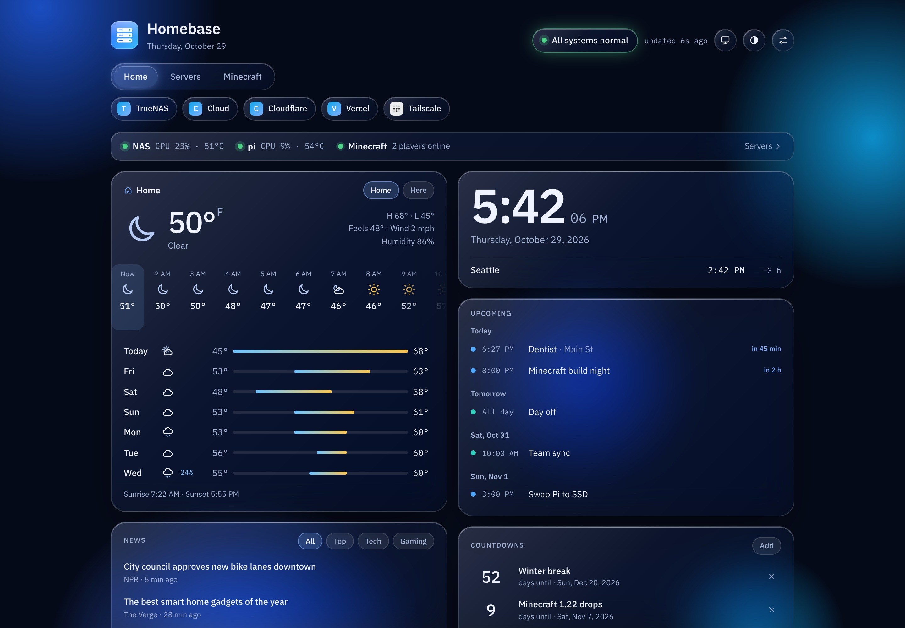
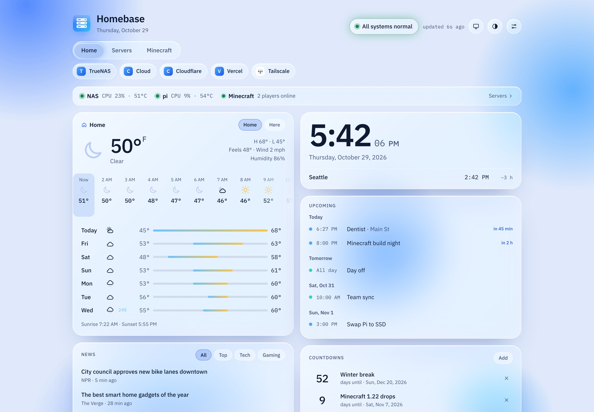
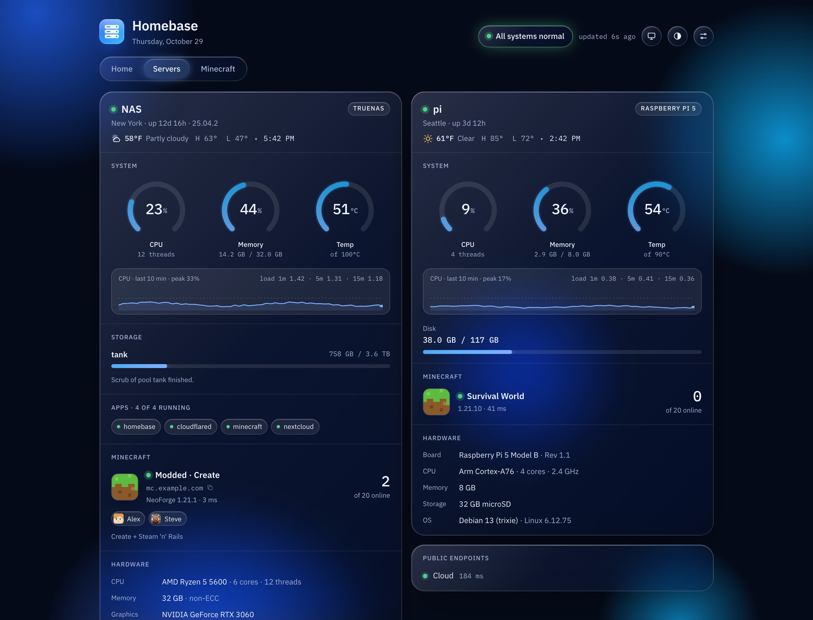
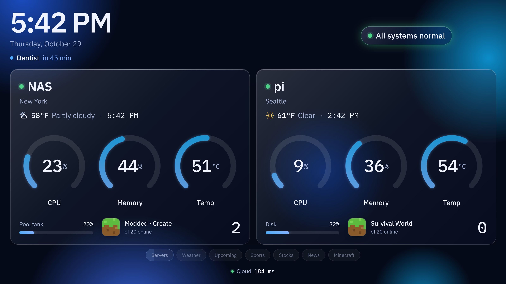
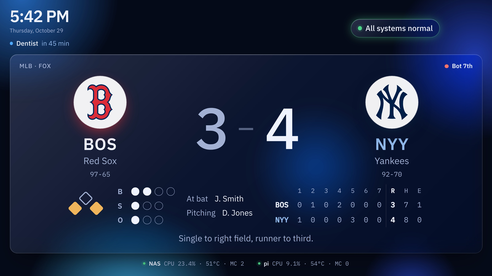
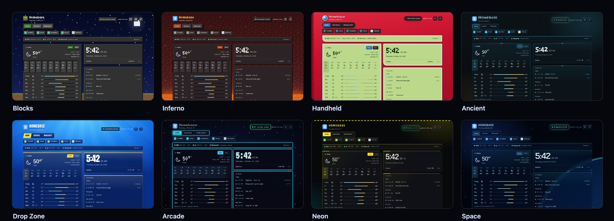
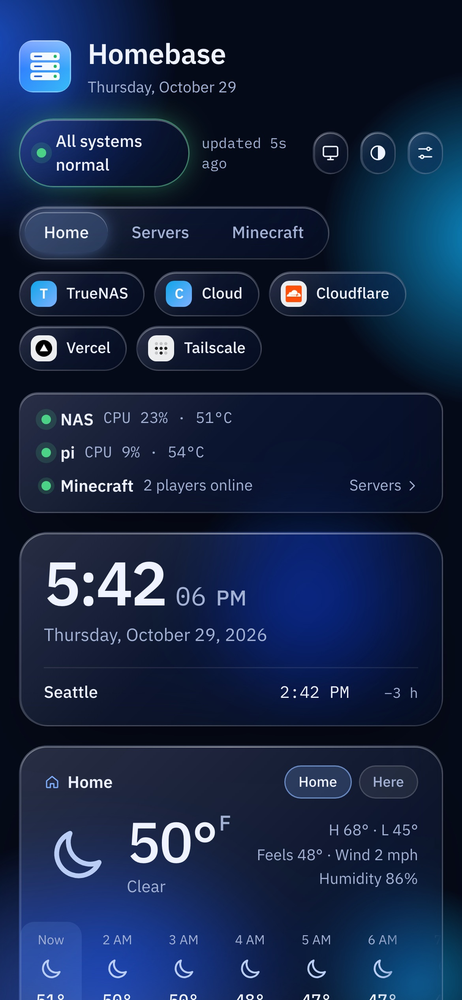

# Homebase

A glassy, self-hosted home dashboard for a home server and a Raspberry Pi, plus everything
else you check every day: weather, calendar, countdowns, live sports scores, stocks and news.

Built with Next.js 16, React 19 and plain CSS. No database is needed for the main site.



## Features

- **Servers**: CPU, memory, temperature (ring gauges and sparklines), storage pools, apps
  and alerts from TrueNAS, hardware specs, and a Raspberry Pi through a small stats agent.
- **Minecraft (optional)**: players online, version and the installed mods (with update checks).
  No Minecraft server? Leave `NAS_MC_PORT` / `PI_MC_PORT` unset and the Minecraft tab never shows.
- **Home tab**: clock, weather (home or where you are), calendar (.ics links), countdowns,
  sports with live scores (ESPN), stocks, and news from any RSS feed.
- **Customizable**: drag cards around right on the page, show or hide them, and pick teams,
  stocks and feeds in Settings.
- **Themes**: Glass (with accent colors), Blocks, Inferno, Handheld, Ancient, Drop Zone,
  Arcade, Neon and Space. Optional game-day colors tint the page in your team's color
  while they're playing.
- **Room display**: a full-screen mode with a big clock, a live scoreboard and rotating cards.
- **Own login**: a password plus Face ID / Touch ID passkeys, signed session cookies, and
  sign-out after 15 minutes idle.
- Works on phones and can be added to the home screen.

## Screenshots

| Light mode | Servers |
| --- | --- |
|  |  |

**Room display**: a big clock, rotating cards, and a live scoreboard when your team plays.

| Room display | Live scoreboard |
| --- | --- |
|  |  |

**Themes**



**On your phone**



## Try it

```sh
pnpm install
pnpm dev
```

Open <http://localhost:8090/?demo> for sample data. Add `&display` for the room display,
or `&game` for a sample live game. `?demo=nomc` shows it without any Minecraft server.

## Run it for real

Settings come from environment variables; see `lib/config.ts` for the full list and
`compose.yaml` for a TrueNAS / Docker example. The main ones:

| Variable | What it's for |
| --- | --- |
| `SESSION_SECRET` | Signs login cookies. Use a long random string. |
| `TRUENAS_API_KEY` | Read-only stats from TrueNAS. |
| `PI_AGENT_URL`, `PI_AGENT_TOKEN` | The Pi stats agent in `pi-agent/`. |
| `NAS_LAT`, `NAS_LON`, `NAS_TZ` | Weather and local time for each server. |
| `TEAMS`, `TICKERS`, `NEWS_FEEDS` | Defaults for the Home tab (also editable in Settings). |
| `CALENDARS` | `Name|https://….ics`, comma-separated. Fetched server-side only. |
| `PUBLIC_HOST` | The address you reach it on, for passkeys (e.g. `dash.example.com`). |

Build a standalone bundle with `pnpm bundle`, then run `node server.js` from it.

Keep secrets in environment variables, never in the code.

## License

MIT
